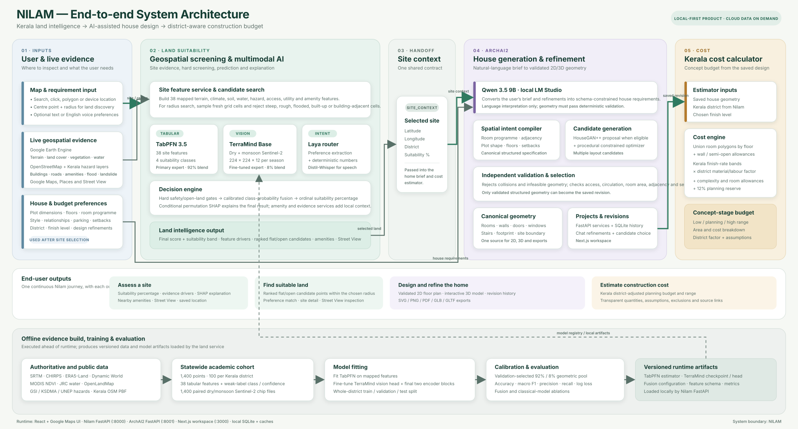

# Nilam system architecture

Nilam is one continuous Kerala housing workflow with three product stages:

1. **Land suitability** screens a selected site or searches a user-defined radius. It combines 38 mapped features through TabPFN with paired dry- and monsoon-season Sentinel-2 imagery through TerraMind, then returns a calibrated suitability percentage, explanations, amenities, Street View, and ranked candidate points.
2. **ArchAI2** receives the selected `site_context`, interprets the house brief with the local Qwen 3.5 9B model, generates candidate floor plans, validates the geometry, and stores a canonical design used by the 2D and 3D views.
3. **Cost calculator** reads the saved design geometry, district, and finish level. It applies Kerala residential rate bands, district material/labour adjustments, measured area allowances, complexity adjustments, and a planning reserve to produce an indicative budget range and breakdown.

## Runtime flow

The solid path in the diagram is the live user journey. The land service builds current site evidence, enforces hard screening rules, performs the TabPFN–TerraMind prediction, and saves the chosen location as `site_context`. ArchAI2 turns the site plus user requirements into validated structured geometry. The cost service then prices that exact saved revision. Laya routes land-search preferences; Distil-Whisper transcribes optional English speech. Google Maps, Places, and Street View provide map interaction and local context.

## Offline model pipeline

The lower lane is separate from live inference. Earth Engine, OSM, hazard layers, and other public sources produce the 1,400-point statewide academic cohort and its paired seasonal Sentinel-2 chips. TabPFN is fitted on the 38 tabular features; TerraMind is fine-tuned on the image pairs. Whole-district splits are used for model selection and evaluation, and the calibrated fusion artifacts are loaded by the local Nilam API.

## Core implementation map

| Architecture area | Core files |
|---|---|
| Statewide data generation | `scripts/build_statewide_dataset.py`, `scripts/extract_osm.py`, `src/kerala_land_lab/earth.py`, `src/kerala_land_lab/current_hazards.py` |
| Satellite chip generation | `scripts/download_satellite_chips.py`, `src/kerala_land_lab/satellite.py` |
| TabPFN and TerraMind training | `scripts/train_statewide.py`, `scripts/train_multimodal.py`, `scripts/calibrate_terramind_tabpfn.py` |
| Runtime prediction and fusion | `src/kerala_land_lab/api.py`, `src/kerala_land_lab/fusion.py` |
| Candidate search and intent routing | `src/kerala_land_lab/search.py`, `src/kerala_land_lab/semantic.py` |
| Nilam map interface | `web/src/main.jsx` |
| ArchAI2 API and generation orchestration | `archai/apps/api/app/main.py`, `archai/apps/api/app/ai/local_model.py`, `archai/apps/api/app/ml/engine.py` |
| Canonical geometry and validation | `archai/apps/api/app/schemas.py`, `archai/apps/api/app/layout.py`, `archai/apps/api/app/simple_home.py`, `archai/apps/api/app/intent_validation.py`, `archai/apps/api/app/exports.py` |
| ArchAI2 design workspace | `archai/apps/web/app/workspace/[id]/page.tsx` |
| Kerala cost estimator | `archai/apps/api/app/cost_estimator.py`, `archai/apps/web/app/workspace/[id]/estimate/page.tsx` |

## Reading the model boundary

The suitability percentage is the calibrated output of the land-screening model. It does not drive house geometry or construction cost. ArchAI2 receives the selected site's location, district, and suitability score as context, while the cost calculator uses the district and the saved house geometry. The three stages remain independently testable but share one product flow and one site handoff contract.
