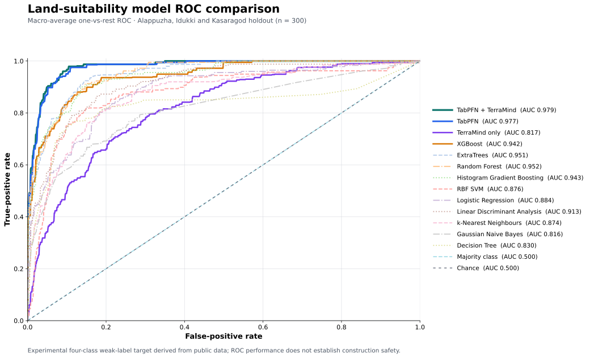

# Land-suitability model comparison

**Target:** four-class experimental public-data screening label. These are not verified building outcomes or probabilities that a house is safe.

**Evaluation:** 1,400 points (100 per Kerala district); train on 900 points from nine districts, use 200 points from Ernakulam and Wayanad for validation, and report the same 300 test points from Alappuzha, Idukki and Kasaragod for every model. All tabular models use the same 38 mapped features. TerraMind additionally reads dry- and monsoon-season Sentinel-2 chips. No test row is used to fit the new baselines. The fusion weights were already selected on validation data.

| Model | Accuracy | Balanced accuracy | Macro precision | Macro recall | Macro F1 | Weighted F1 | Macro ROC-AUC | Log loss |
|---|---:|---:|---:|---:|---:|---:|---:|---:|
| TabPFN + TerraMind | 90.0% | 86.4% | 88.9% | 86.4% | 86.9% | 90.0% | 0.979 | 0.275 |
| TabPFN | 89.0% | 84.2% | 86.7% | 84.2% | 85.0% | 88.9% | 0.977 | 0.290 |
| TerraMind only | 62.0% | 45.5% | 56.4% | 45.5% | 41.9% | 57.4% | 0.817 | 0.934 |
| XGBoost | 81.0% | 74.6% | 72.4% | 74.6% | 73.4% | 81.4% | 0.942 | 0.516 |
| ExtraTrees | 82.7% | 77.9% | 78.5% | 77.9% | 77.4% | 82.9% | 0.951 | 0.549 |
| Random Forest | 84.0% | 73.4% | 81.7% | 73.4% | 75.2% | 83.0% | 0.952 | 0.477 |
| Histogram Gradient Boosting | 84.0% | 77.1% | 76.8% | 77.1% | 76.8% | 84.0% | 0.943 | 0.649 |
| RBF SVM | 77.3% | 62.0% | 69.7% | 62.0% | 63.5% | 75.4% | 0.876 | 0.683 |
| Logistic Regression | 71.0% | 69.9% | 68.2% | 69.9% | 66.6% | 72.4% | 0.884 | 0.778 |
| Linear Discriminant Analysis | 77.3% | 70.9% | 75.4% | 70.9% | 71.6% | 77.6% | 0.913 | 0.737 |
| k-Nearest Neighbours | 72.7% | 55.7% | 64.7% | 55.7% | 58.5% | 70.2% | 0.874 | 1.145 |
| Gaussian Naive Bayes | 71.7% | 64.1% | 73.1% | 64.1% | 65.2% | 73.0% | 0.816 | 3.823 |
| Decision Tree | 74.0% | 69.6% | 64.7% | 69.6% | 66.0% | 75.6% | 0.830 | 2.326 |
| Majority class | 55.0% | 25.0% | 13.8% | 25.0% | 17.7% | 39.0% | 0.500 | 7.253 |

Macro precision, recall, F1 and one-vs-rest ROC-AUC average the four classes equally; weighted F1 gives more influence to common classes. Balanced accuracy is the mean class recall. Higher is better except for log loss.

On these 300 points, fusion changes macro F1 by +1.91 percentage points versus TabPFN. Fusion changed 9 predictions: 6 became correct and 3 became incorrect.

The current app geometrically combines TabPFN with the trained **TerraMind multimodal head**. Agreement and disagreement weights are read from the audited fusion artifact. **TerraMind only** remains the vision-only ablation.

## Per-class F1 on the test districts

| Model | Screen out | Low | Moderate | Higher |
|---|---:|---:|---:|---:|
| TabPFN + TerraMind | 84.2% | 90.6% | 78.8% | 94.2% |
| TabPFN | 81.4% | 87.9% | 76.6% | 94.3% |
| XGBoost | 68.6% | 69.7% | 62.0% | 93.5% |
| ExtraTrees | 69.0% | 79.6% | 70.8% | 90.3% |

## Interpretation and limits

The labels are calculated from public-data rules that use many of the 38 tabular inputs. High scores therefore mainly show that a model reproduces those rules, not that it can identify safe, vacant or legally buildable plots. TerraMind's image branch has an inherent disadvantage on this target because the target was not labelled from satellite images. The test districts have appeared in prior development reports, so this is a retrospective comparison and should not be presented as a fresh confirmatory result. Independent expert labels and a new spatial holdout are needed for claims about real-world suitability.

Reproduce with `PYTORCH_ENABLE_MPS_FALLBACK=1 .venv-multimodal/bin/python scripts/evaluate_model_comparison.py --stage all`. The script checks the dataset SHA-256, point IDs and split before combining predictions. Full per-class metrics and confusion matrices are in `docs/model-comparison.json`.
